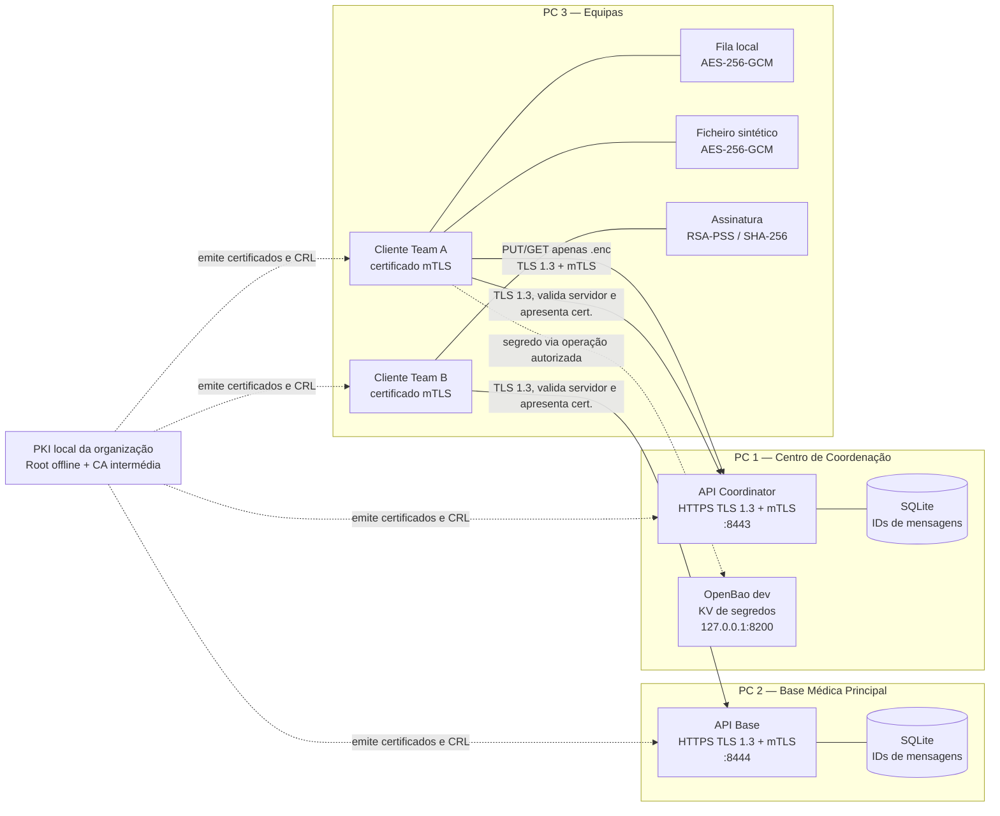

# Arquitetura da PoC

## Diagrama lógico

## Limites e topologia distribuída

As bridges Docker existem apenas dentro de cada computador. Cada API publica uma porta no host, e os restantes computadores acedem ao IP Tailscale do host (por exemplo, `https://<IP-TAILSCALE>:8443`). O certificado do servidor tem de incluir esse IP no SAN. A VPN fornece conectividade e reduz exposição, mas a autenticação e cifragem continuam a ser feitas por TLS/mTLS.

OpenBao está intencionalmente ligado a `127.0.0.1:8200`, logo só o host do coordinator o alcança. Para acessos remotos, o fluxo cliente deve passar pelo serviço/API autorizado ou o grupo terá de alterar explicitamente a exposição/rede e configurar políticas, TLS e autenticação de produção. O modo dev do OpenBao não é adequado a dados reais.

## Fluxos

1. O cliente valida cadeia, nome/IP e CRL do certificado do servidor e apresenta o seu certificado e prova de posse da chave no handshake TLS 1.3.
2. O servidor valida cadeia, período, uso e CRL do certificado do cliente; só então processa `POST /messages`.
3. O servidor guarda o ID numa base SQLite montada em `/data`. IDs repetidos recebem HTTP 409, inclusive após reinício do processo.
4. Ficheiros de demonstração são cifrados com AES-256-GCM; assinaturas usam uma chave RSA-3072 distinta das identidades TLS.
5. A PKI emite/revoga identidades e distribui a CRL atualizada. A atualização requer distribuição do bundle e reinício dos serviços que carregam a CRL.
